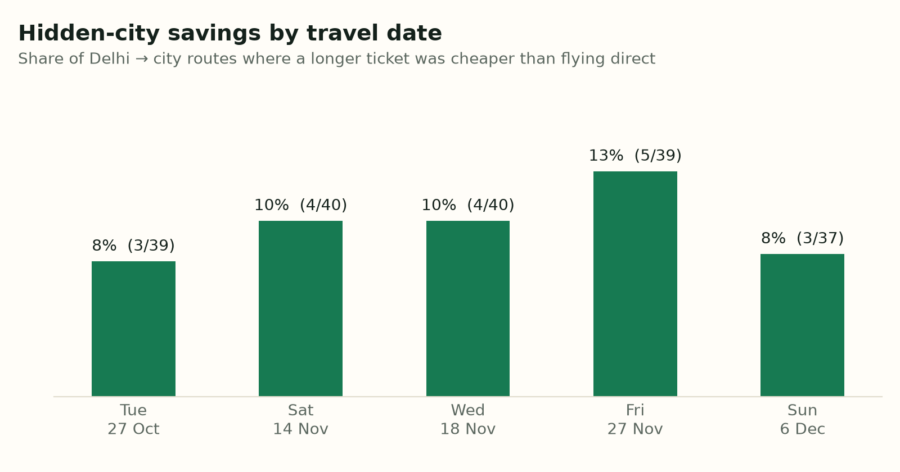
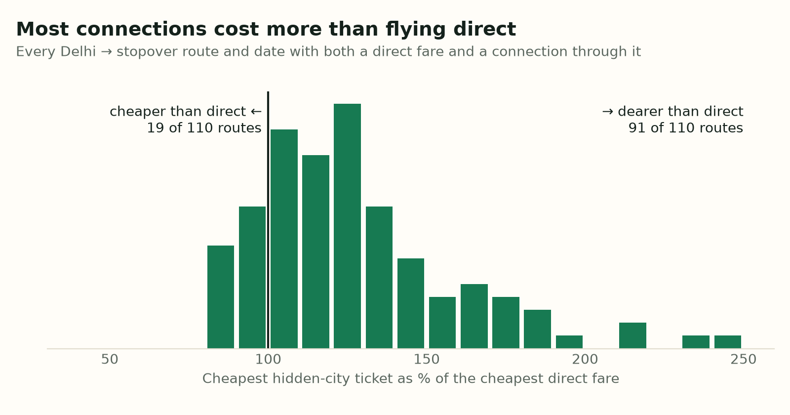
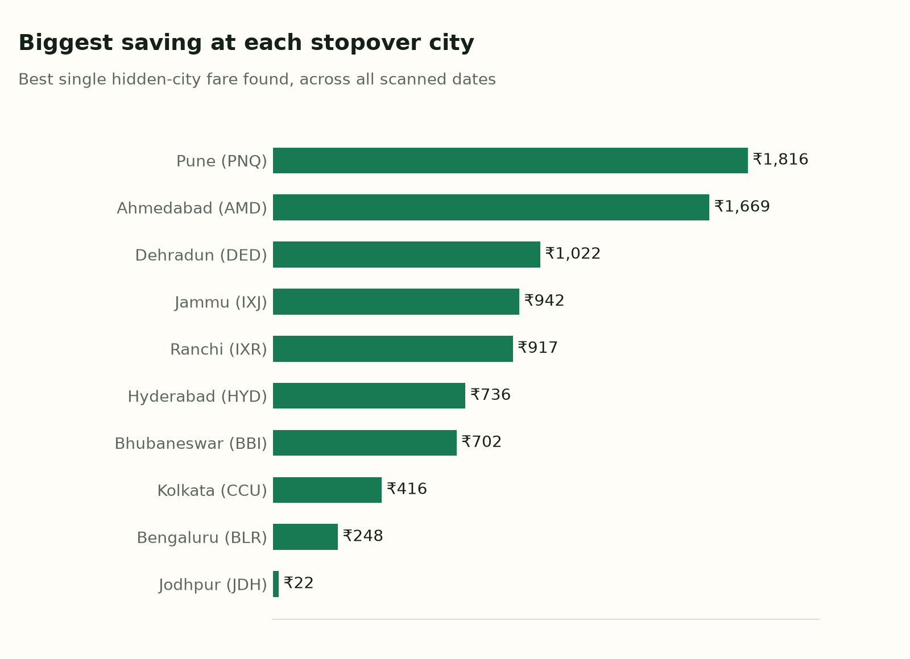

# Hidden-City

How often is a connecting flight out of Delhi cheaper than flying direct to the city it stops in?

**Hidden-city ticketing** (or "skiplagging") is when a ticket A → B → C costs less than a ticket A → B. A traveller can book the longer trip and simply leave the airport at B. This project measures how common that is on Indian domestic routes from Delhi, and how much it saves.

This is an **analysis tool, not a booking tool**.

## Findings

I searched one-way fares from **Delhi to 41 Indian cities on 5 travel dates** (Tue 27 Oct, Sat 14 Nov, Wed 18 Nov, Fri 27 Nov, Sun 6 Dec 2026): **205 searches and 1,935 itineraries**, captured on 18–19 October 2026.

**Hidden-city fares exist, but they're the exception.**

- **19 of 195 routes (9.7%)** had a connecting ticket cheaper than the cheapest direct flight to its stopover city. A "route" here is Delhi → a city, on one date.
- Counting only routes where a connection through that city was on sale at all, it's **19 of 110 (17%)**. On a typical route, the cheapest such connection cost **23% more** than flying direct.
- When there was a saving, the best one averaged **₹676**, and the biggest was **₹1,816** (Delhi → Pune on 14 Nov, on a ticket booked to Goa).
- **The same plane, sold for less.** In 14 cases Google also listed the first flight as a ticket on its own, and every one of those 14 cost more alone than as part of the longer trip. Example: SpiceJet SG 160 Delhi → Jammu costs ₹7,106 alone, but ₹6,306 as Delhi → Jammu → Srinagar on the same plane.
- **Jammu is the standout.** It had a saving on **all 5 dates**: 13 of the 32 cheaper tickets, mostly through-flights that continue to Srinagar or Leh.
- **IndiGo accounts for 28 of the 32 cheaper tickets** (SpiceJet the other 4), even though Air India had the most itineraries overall.
- **The date matters less than the route.** 8–13% of routes had a saving on every date.







The full data is reproducible from the cache: `python -m hiddencity report` writes `data/results.db` and CSVs, and `python -m hiddencity charts` redraws these charts.

## Trip search (web app)

Search any route between **88 Indian airports** on any future date. For example, **Delhi → Mumbai on 18 Nov** shows the best normal ticket next to the best hidden-city ticket (a longer ticket that stops in Mumbai first).

Live at **[rana.beer/hiddencity](https://rana.beer/hiddencity)**. To run it locally:

```bash
python app.py          # then open http://localhost:5050/hiddencity/
python -m hiddencity find DEL BOM 2026-11-18     # the same search in the terminal
```

A search first shows normal fares (1 API search). Hidden-city fares are checked only when you press **Find hidden-city deals**, which keeps the free API plan going further. Each visitor can trigger at most 15 paid searches a day, and the site stops making new searches when the monthly balance runs low.

**Deploying:** the app runs on [Vercel](https://vercel.com) as a Flask function (`app.py`, settings in `vercel.json`). Static files live in `public/` so Vercel's CDN serves them. Set `SERPAPI_KEY` in the Vercel project's environment variables.

A trip search runs 1 search for the trip itself, plus searches to cities *beyond* the destination (6 for big hubs, 2 for smaller airports, since few people connect through them). Cities are picked from ones the cache has already seen routing through the destination, then by geography: a city counts as "beyond" if the destination is roughly on the way there ([`airports.py`](hiddencity/airports.py)). Saved answers are reused for 6 hours, then searched again so prices stay current; the page shows how old the prices are. Website searches are saved in `cache/live/`, separate from the research snapshot, and the scan leaves 5 of SerpApi's 50 searches an hour free for the website.

## How the research scan works

1. **Search.** For each city in [`hiddencity/config.py`](hiddencity/config.py), search one-way DEL → city on Google Flights (via [SerpApi](https://serpapi.com/google-flights-api)).
2. **Flatten.** Each result is an itinerary with one or more legs. The first leg's arrival airport is where a hidden-city traveller would get off. ([`parse.py`](hiddencity/parse.py))
3. **Compare.** For every connecting itinerary DEL → hub → city, compare its price with the cheapest **direct** DEL → hub flight on the same day. If it's cheaper, that's a hidden-city fare. ([`detect.py`](hiddencity/detect.py))

One search to a city covers every hub its connections stop at, so 41 searches cover all 41 hub routes for one date, instead of a separate set of searches for each route.

Every API answer is cached to disk and every paid search is logged, so nothing is paid for twice and the free plan's limits (250/month, 50/hour) are respected. ([`client.py`](hiddencity/client.py))

## Run it yourself

```bash
git clone https://github.com/RanabeerChhabra/Hidden-City.git
cd Hidden-City
python3 -m venv .venv
source .venv/bin/activate
pip install -r requirements.txt -r requirements-dev.txt
cp .env.example .env        # then put your SerpApi key in .env
```

```bash
python -m hiddencity budget                                 # searches left (free)
python -m hiddencity scan --dates 2026-11-18 --max-searches 5
python -m hiddencity scan --dates 2026-11-18 2026-11-21 --wait   # full scan
python -m hiddencity report                                 # analyse the cache
python -m pytest                                            # run the tests
```

`report` writes `data/results.db` (SQLite) and `data/itineraries.csv` / `data/opportunities.csv`.

## Limitations

- **One-way only.** On a return ticket, skipping a leg usually cancels the rest of the booking.
- **Cabin bags only.** Checked bags go to the final destination on the ticket.
- **Airlines prohibit it.** Contracts of carriage forbid deliberately skipping segments. Airlines can cancel tickets, charge the fare difference, or penalise frequent-flyer accounts.
- **Disruption risk.** If the first leg is cancelled, the airline may rebook you through a different hub.
- **Coverage.** Google Flights doesn't show every fare or every airline on every search, and results are a snapshot of the dates searched.
- **Delhi only** for the research scan. Every route starts at DEL; the trip search covers any of 88 airports.
- **Small sample.** 5 dates and one snapshot (prices captured 18–19 Oct 2026). Fares change daily, so these are indicative rates, not a forecast.
- **Same airport only.** A connection through Navi Mumbai isn't counted as a Mumbai saving.
